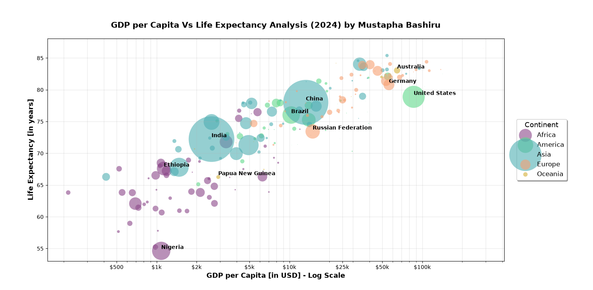

# Project log: GDP per capita vs life expectancy, 2024

Author: Mustapha Bashiru
Tools: Python (pandas, NumPy, matplotlib)
Inputs: GDP_Per_Capita.csv, Pop.csv, Life_expectancy.csv
Script: afrifonders.py
Output: life_expectancy_vs_gdp_percapita.png

## Objective

Show how GDP per capita relates to life expectancy across countries in 2024, and where Nigeria sits compared with the rest of Africa and the world.

## Data collection

The 2024 data on life expectancy, population and GDP per capita comes from the World Bank Data Bank. It was downloaded as three CSV files, one per indicator. Each file has country_name, iso3 and continent columns, plus one column per year including 2023, 2024 and 2025.

[To add: exact World Bank indicator names, download date, and whether GDP per capita is in current or constant USD.]

## Data cleaning

1. Imported the three files with pandas.
2. Renamed the year columns with a prefix (GDP_2024, Pop_2024, Life_2024, and the same for 2023 and 2025) so they stay distinct after merging.
3. Included a duplicate check on iso3 for each file.
4. Merged the three tables on country_name, iso3 and continent with an outer join. The one-to-one validation makes pandas raise an error if any country appears more than once in a file.
5. Kept six columns: country_name, iso3, continent, GDP_2024, Pop_2024 and Life_2024.
6. Dropped every row with a missing continent, GDP per capita, population or life expectancy value for 2024. About 200 countries remained. Some African countries are not in the final sample.

## Methodology

The analysis is a bubble scatter plot, read visually. No regression was fitted.

- X axis: GDP per capita in USD on a log scale, so each step along the axis is a multiple of income instead of a fixed dollar amount. Ticks run from \$500 to \$100k.
- Y axis: life expectancy in years.
- Bubble size: population. Bubble area is population in millions multiplied by 5.
- Colour: continent, with transparency set to 0.6 so overlapping bubbles stay visible.
- Labels: the two most populous countries on each continent, selected with nlargest on Pop_2024.
- Output: 20 by 11 inch figure saved at 300 dpi.

The script saves the figure under the long file name GDP_per_Capita_VsLife_Expectancy_Analysis_2024_by_Mustapha_Bashiru.png. In the repository it is named life_expectancy_vs_gdp_percapita.png.

## Version notes

- Fixed the continent key in the colour map from 'Americas' to 'America' to match the data, so America now plots in green instead of the gray fallback.
- Corrected the chart title to "GDP per Capita Vs Life Expectancy Analysis (2024) by Mustapha Bashiru".
- Neither change affects any result in the interpretation.

## Chart interpretation

Nigeria is not the giant of Africa. It is not a stronger economy than the other African countries in any way that matters. Total GDP means little without population, and Nigeria's GDP is large because its population is large. An economy is doing well when its people have a good quality of life, and GDP per capita is the indicator of that. Governments and economies exist for Pareto efficiency, the betterment of humanity. A bigger GDP or a bigger population without a good quality of life is worth nothing.

### What the chart shows

Nigeria has a GDP per capita of about \$1,100 and a life expectancy of about 55 years. Among countries at a similar income, that is the lowest life expectancy in the sample. Almost all African countries do better than Nigeria on life expectancy. Some have more than 75 years at about \$5,000 GDP per capita, while Nigeria is below 60 years at about \$1,100.

The purple countries are African. All of them are below 80 years of life expectancy, and almost all are below \$10,000 GDP per capita. The gap in quality of life between Africa and the other continents is wide.

In general, countries with a higher GDP per capita have a longer life expectancy. India has about \$2,600 and 72 years. China has about \$12,500 and 78 years. The United States has about \$85,000 and 79 years. Some small European countries have about \$100,000 and 84 years. In Oceania, Australia has about \$64,000 and 83 years.

The relationship is general, not exact. Russia (about \$14,000, 74 years) is below Brazil (about \$10,300, 76 years) and China, which have lower incomes. The United States is below Germany (about \$55,000, 81 years) and Australia, which also have lower incomes. Papua New Guinea (about \$2,900, 66 years) is below India and Ethiopia (about \$1,150, 68 years). Income helps, but it does not decide the outcome on its own.

### Population

Bubble size shows population. Nigeria has the biggest population among the African countries in the data, and the chart shows that a bigger population does not mean a bigger GDP per capita. China and India are the most populous countries in the world.

GDP per capita is GDP divided by population, so population affects it directly. If population grows faster than production, inflation and poverty rise, and quality of life falls. That holds here: the African countries with a higher GDP per capita than Nigeria have smaller populations, which is why their GDP per capita and life expectancy are higher.

### Conclusion

Nigeria is not the giant of Africa. Its quality of life is very low, its population is bigger than its resources, and that is why Nigerians are suffering.

## Limitations

- The data covers one year, so it shows association, not cause.
- GDP per capita is an average and does not show how income is shared.
- The population theory is not tested. Population appears only as bubble size.
- Some African countries are missing, so statements about Africa apply to the sample only.
- Only the two most populous countries per continent are labelled.
- Life expectancy is one measure of quality of life.

## Next steps

- Fit a trend line on log GDP per capita and rank every country by its gap from the line.
- Test the population theory with population growth and GDP growth for Nigeria and its African peers.
- Add under-5 mortality, maternal mortality, health spending and conflict data to explain the gap between Nigeria and countries like Ethiopia and India.
- Extend the series beyond 2024 (the 2023 and 2025 columns are already in the data).
- Add an income distribution measure such as the Gini index.
